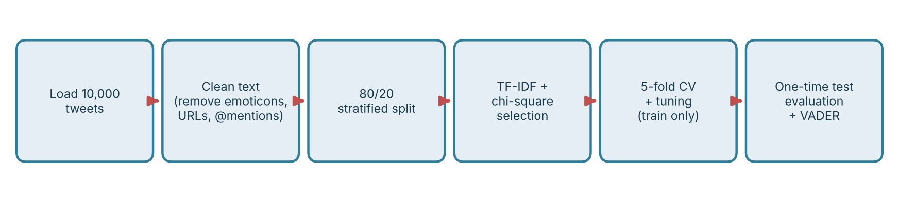
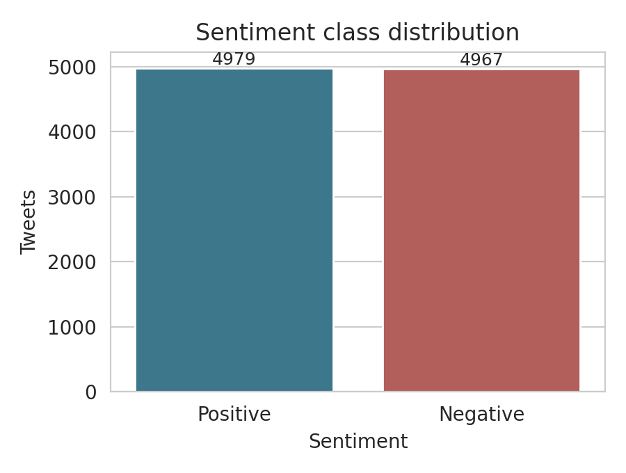
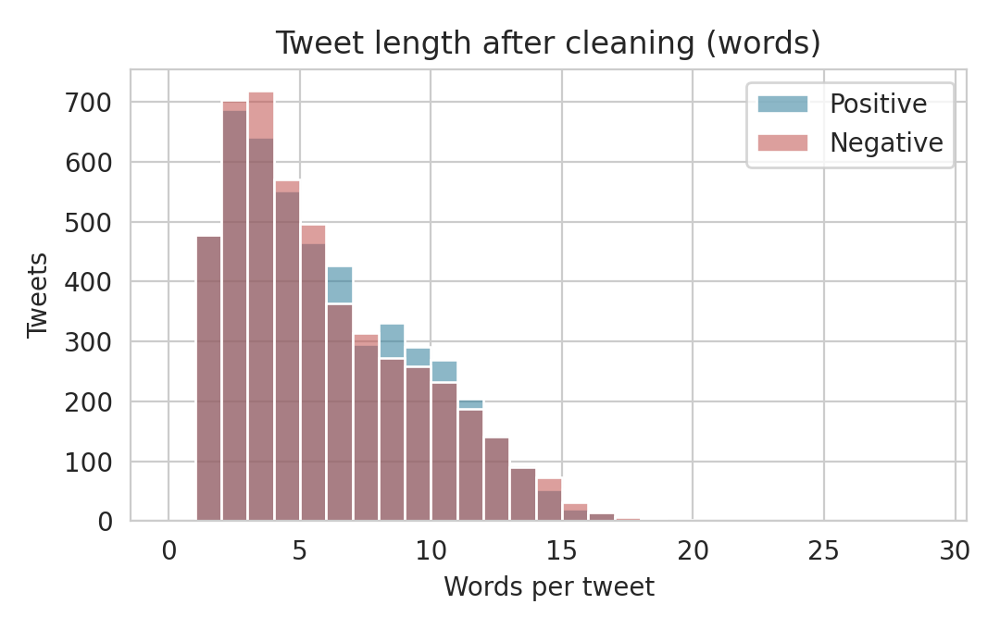
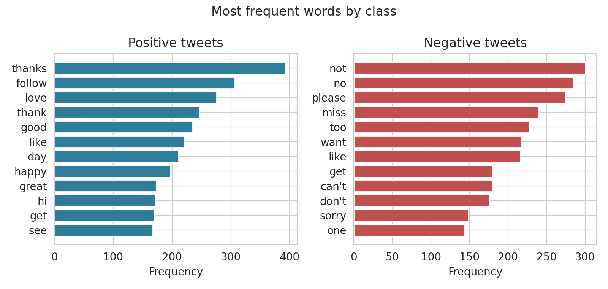
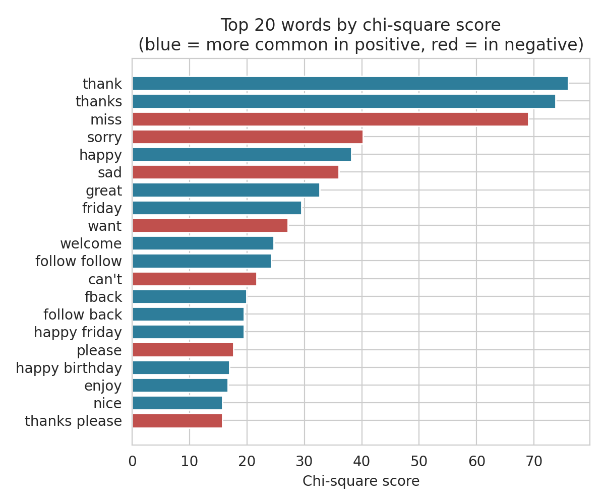
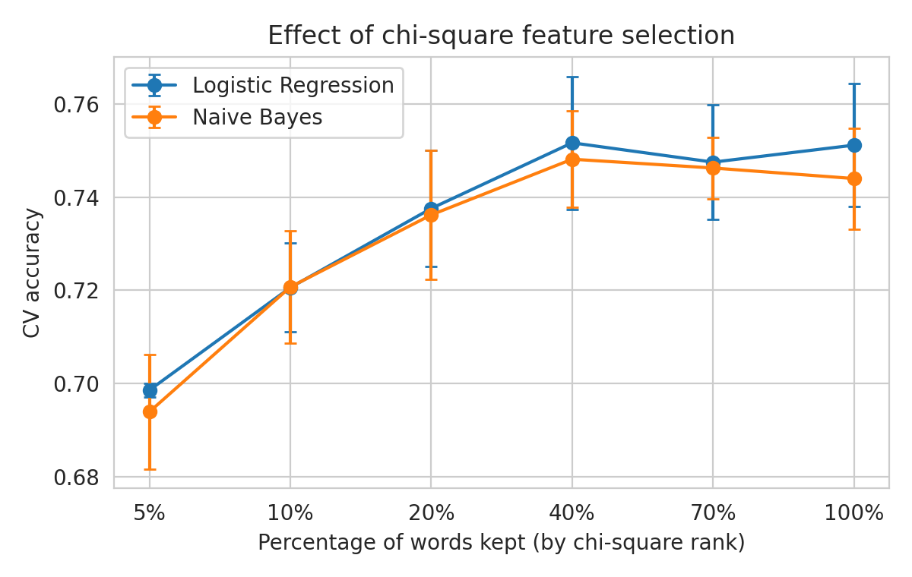
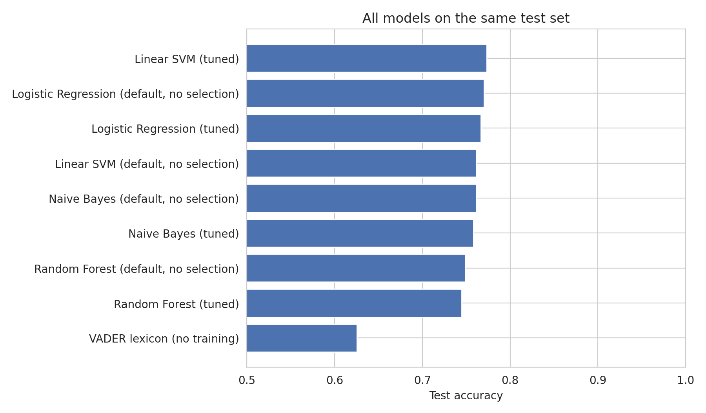
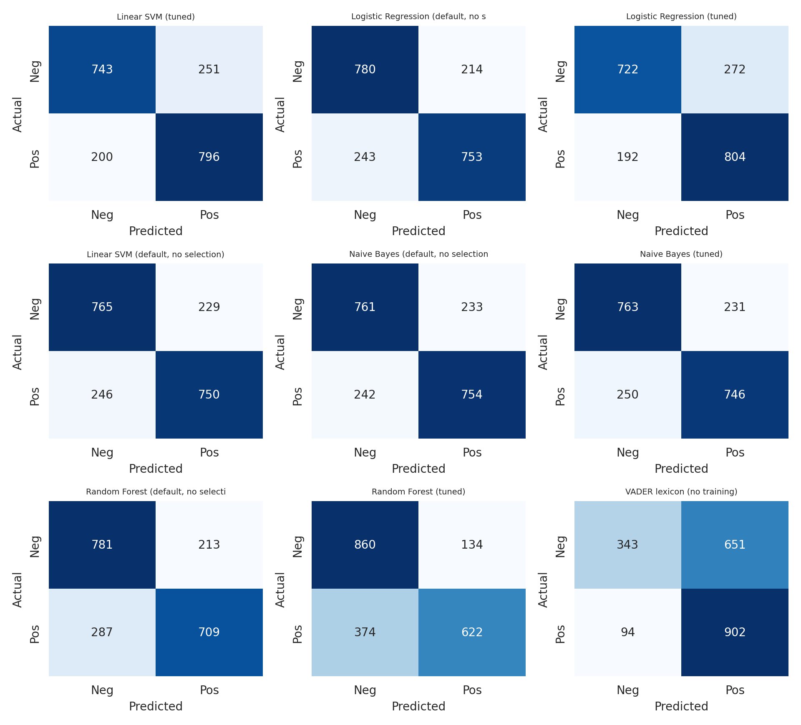

# SRM UNIVERSITY–AP
## DEPARTMENT OF COMPUTER SCIENCE AND ENGINEERING
### MACHINE LEARNING PROJECT REPORT (CLA-3)

---

# Sentiment Analysis of Social Media Using Machine Learning

**Submitted in partial fulfillment of the requirements for the course:**  
**MACHINE LEARNING**

### Submitted by:
| Name | Registration No. |
| :--- | :--- |
| **Akshita Modi** | AP24110010386 |
| **Lakshay** | AP24110010677 |
| **Mohana Krishna Reddy Pittu** | AP24110011262 |
| **Nadimpally Dheva Harshit** | AP24110011553 |
| **Md Ahab Firoz** | AP24110011219 |

**Under the guidance of:**  
**Ajay Dilip Kumar**  
*Academic Year 2026–2027*

---

## Abstract
Social media platforms produce a constant stream of short, informal text in which people express opinions and feelings. Sentiment analysis, the task of deciding whether a piece of text is positive or negative, helps businesses, public bodies and researchers understand public opinion at scale. This case study applies supervised machine learning to classify tweets as positive or negative.

The NLTK Twitter Samples corpus, containing 10,000 labelled tweets, was used. After removing emoticons, URLs, mentions and tweets left empty by cleaning, 9,946 tweets remained and were split into 7,956 training and 1,990 test tweets. Text was converted into TF-IDF features (single words and word pairs), reduced with chi-square feature selection, and classified with four algorithms (Logistic Regression, Naive Bayes, Linear SVM and Random Forest). All tuning used 5-fold cross-validation on the training set only, and each final model was scored once on the untouched test set and compared with the VADER lexicon, which needs no training. The tuned Linear SVM achieved the highest accuracy (0.773) and F1-score (0.779), Logistic Regression the highest recall (0.807) and Random Forest the highest precision (0.823), while VADER reached only 0.626 accuracy. The differences between the three linear models are smaller than the uncertainty of the test set, so they are best regarded as performing at a similar level.

---

## 1. Introduction
Millions of people share opinions about products, events and daily life on social media every day. Reading this volume of text manually is impossible, so organisations rely on automatic sentiment analysis to track customer satisfaction, brand reputation and public mood.

Social media text is difficult for traditional text analysis. Tweets are short, informal and full of abbreviations, hashtags, mentions and spelling variations, and they carry little context. Machine learning offers a practical approach: a classifier learns from labelled examples which words and word combinations are associated with positive or negative sentiment.

The objective of this project is to build and compare classification models that predict whether a tweet is positive or negative, to study which words are most informative using chi-square feature selection, and to measure how much cross-validated hyperparameter tuning helps. This is an offline study on a fixed dataset, not a live monitoring system.

---

## 2. Dataset Description
The project uses the Twitter Samples corpus distributed with the Natural Language Toolkit (NLTK). It contains 5,000 positive and 5,000 negative tweets, 10,000 in total. The tweets were labelled automatically from the emoticons they contained (for example a smiling face marks a positive tweet and a sad face a negative one), rather than by human readers. Because the label is derived from the emoticon, all emoticons were removed from the text before training; otherwise a model could simply learn to read the label. The main figures of the dataset are listed in Table 1.

### Table 1: Summary of the dataset
| Item | Value |
| :--- | :--- |
| Source | NLTK Twitter Samples |
| Raw tweets | 10,000 |
| Duplicate tweets removed | 0 |
| Tweets after cleaning | 9,946 |
| Positive tweets (label 1) | 4,979 |
| Negative tweets (label 0) | 4,967 |
| Training tweets (80%) | 7,956 |
| Test tweets (20%) | 1,990 |
| Average length after cleaning | 5.49 words |
| TF-IDF features (training set, word pairs, min_df = 2) | 5,730 |

---

## 3. Methodology
The implementation was carried out in Python using Google Colab, Pandas, NumPy, Matplotlib, Seaborn, NLTK and Scikit-learn. The workflow included data loading, cleaning, train–test splitting, TF-IDF feature extraction, chi-square feature selection, cross-validated tuning, final evaluation and visualization, as shown in Figure 1.

  
*Figure 1. Workflow of Sentiment Analysis of Social Media Using Machine Learning.*

### 3.1 Data Preprocessing
- The 10,000 tweets were loaded and checked for duplicates; none were found (0 removed).
- HTML entities, URLs, @mentions and the retweet marker were removed, as were all emoticons, so that the label cannot be read directly from the text.
- Text was converted to lower case, the `#` sign was dropped (the hashtag word is kept), and everything except letters and apostrophes was removed.
- English stop words were removed, but negation words (*no, not, never, can't, don't* and similar) and the intensity words *too, very, most* and *more* were kept because they change the meaning of a sentence.
- Tweets that were empty after cleaning were dropped, leaving 9,946 tweets (4,979 positive, 4,967 negative).
- The data was divided into 80% training tweets (7,956) and 20% test tweets (1,990) using a stratified split with a fixed random state of 42.

### 3.2 Feature Extraction and Chi-Square Selection
Each tweet was converted into a numerical vector using TF-IDF, which gives a high weight to words that are frequent in a tweet but rare across tweets. Both single words and word pairs (bigrams) were considered, with sublinear term-frequency scaling.

Chi-square feature selection then scores every word by how strongly its occurrence depends on the class. A large score means the word is tied to one sentiment (for example “thanks” or “sad”), and a score near zero means it is spread evenly. Only the top percentage of words by score is kept. To avoid information leaking from validation data into training, selection is carried out inside the pipeline, so it is re-fitted on the training part of every cross-validation fold and never on the full dataset.

### 3.3 Model Development
Four supervised classifiers were implemented, each inside a pipeline of TF-IDF, chi-square selection and classifier, and a lexicon method was added as a baseline:
1. **Logistic Regression:** predicts the probability that a tweet is positive from a weighted sum of word features.
2. **Multinomial Naive Bayes:** a probabilistic model that assumes words occur independently given the class and is fast and well suited to word counts.
3. **Linear Support Vector Machine (SVM):** finds the straight boundary that separates positive and negative tweets with the widest margin.
4. **Random Forest:** combines many decision trees trained on random parts of the data to reduce overfitting.
5. **VADER (baseline):** a rule-based sentiment lexicon that scores a tweet from a pre-built word list and needs no training. A tweet was called positive when its compound score was zero or higher.

### 3.4 Cross-Validation and Hyperparameter Tuning
The training set was divided into five stratified folds. A model is trained on four folds and scored on the fifth, this is repeated five times, and the accuracies are averaged. The whole pipeline was tuned together, so feature settings and classifier settings were chosen jointly. Logistic Regression, Naive Bayes and Linear SVM were tuned with a full grid search, and Random Forest with a randomized search of 8 combinations because it is much slower. The values tried are shown in Table 2. The test set was not used at any point during tuning.

### Table 2: Hyperparameters tuned
| Parameter | Meaning | Values tried |
| :--- | :--- | :--- |
| `ngram_range` | Single words only, or words plus word pairs | `(1,1)`, `(1,2)` |
| `min_df` | Ignore words in fewer than this many tweets | `1`, `2` |
| Chi-square percentile | Share of top-scoring words kept | `25`, `50`, `100` |
| Logistic Regression `C` | Inverse regularisation strength | `0.1`, `1`, `10` |
| Naive Bayes `alpha` | Smoothing for unseen words | `0.1`, `0.5`, `1.0` |
| Linear SVM `C` | Penalty for misclassified tweets | `0.1`, `0.5`, `1`, `2` |
| Random Forest | Number of trees, depth, leaf size | Randomized search |

### 3.5 Evaluation Metrics
The models were compared on the test set using the following metrics, with positive sentiment as the positive class:
- **Accuracy:** the proportion of all tweets classified correctly.
- **Precision:** of the tweets predicted positive, how many really are positive.
- **Recall:** of the truly positive tweets, how many were found.
- **F1-Score:** the harmonic balance between precision and recall.
- **Confusion Matrix:** a table of correct and incorrect classifications.
- **95% confidence interval:** a bootstrap interval for accuracy, used to judge whether differences between models are larger than chance.

---

## 4. Implementation and Visualization
The project was implemented in a Google Colab notebook using Pandas for data handling, NumPy for numerical calculations, NLTK for the dataset, stop words and VADER, Matplotlib and Seaborn for visualization, and Scikit-learn for feature extraction, selection, model training and evaluation.

The class distribution (Figure 2) shows that the two classes are almost perfectly balanced, so accuracy is a fair measure here. The tweet-length histogram (Figure 3) shows that tweets are very short after cleaning, 5.49 words on average, which leaves little text for a model to work with. The most frequent words in each class (Figure 4) show positive tweets dominated by words such as *thanks, follow, love* and *good*, and negative tweets by *not, no, please* and *miss*.

|  |  |
| :---: | :---: |
| *Figure 2. Sentiment class distribution.* | *Figure 3. Tweet length after cleaning (words).* |

  
*Figure 4. Most frequent words by class.*

---

## 5. Results and Discussion

### 5.1 Chi-Square Feature Selection
Figure 5 lists the 20 words and word pairs with the highest chi-square scores, computed on the training tweets only. The strongest positive indicators are “thank” (75.9) and “thanks” (73.7), followed by “happy”, “great”, “friday” and “welcome”. The strongest negative indicators are “miss” (69.0), “sorry” (40.2), “sad” (36.0), “want” (27.1) and “can’t” (21.7). Expressions of gratitude and greeting therefore mark positive tweets, while longing, apology and inability mark negative ones.

  
*Figure 5. Top 20 words by chi-square score (blue = positive, red = negative).*

Frequency alone is not enough to separate the classes: “like” and “get” appear among the most frequent words of both classes (221 and 216 times for “like”). Chi-square helps because it rewards words that are concentrated in one class. Table 3 and Figure 6 show whether keeping only the top-ranked words changes accuracy.

### Table 3: Cross-validated accuracy against the percentage of words kept
| Words kept | Logistic Regression | Naive Bayes |
| :--- | :--- | :--- |
| **5%** | 0.699 | 0.694 |
| **10%** | 0.721 | 0.721 |
| **20%** | 0.738 | 0.736 |
| **40%** | 0.752 | 0.748 |
| **70%** | 0.747 | 0.746 |
| **100%** | 0.751 | 0.744 |

  
*Figure 6. Effect of chi-square feature selection on cross-validated accuracy.*

Accuracy rises quickly up to 20–40% of the words and then flattens. Keeping 40% of the words was as accurate as keeping all of them (0.752 against 0.751 for Logistic Regression and 0.748 against 0.744 for Naive Bayes), and these differences are within one standard deviation across folds (about 0.01). Chi-square selection therefore removes up to about 60% of the vocabulary without a measurable loss, which gives a smaller and faster model, but it does not by itself make the model more accurate. Keeping only 5% of the words clearly hurts (about 0.69–0.70).

### 5.2 Cross-Validation Results
Table 4 shows the best setting found for each classifier and its cross-validated accuracy. All four classifiers selected word pairs (`ngram_range (1,2)`), and the three models other than Random Forest also preferred `min_df = 1`, so rare words were useful. The three models score within 0.003 of each other (0.755 to 0.758), well inside the fold-to-fold spread of about 0.01. Random Forest was clearly lower (0.728) and also by far the slowest: 181.8 seconds for its 8 candidates, against 13.7 to 39.4 seconds for the other three models.

### Table 4: Five-fold cross-validation results of the tuned models (training set)
| Model | CV accuracy | Std. dev. | Features kept | Best settings |
| :--- | :--- | :--- | :--- | :--- |
| **Logistic Regression** | 0.756 | 0.010 | 9,963 (25%) | C = 10 |
| **Naive Bayes** | 0.755 | 0.008 | 39,852 (100%) | alpha = 1.0 |
| **Linear SVM** | 0.758 | 0.010 | 19,926 (50%) | C = 0.5 |
| **Random Forest** | 0.728 | 0.010 | 2,865 (50%) | 400 trees, depth 80, min_df = 2 |

### 5.3 Test-Set Performance
Each final model was evaluated once on the 1,990 test tweets (994 negative, 996 positive). Table 5 shows the values obtained for the four tuned classifiers and the VADER baseline; the best value among the four classifiers in each column is shown in bold.

### Table 5: Test-set performance of the tuned models and VADER baseline
| Model | Accuracy | Precision | Recall | F1-Score | 95% CI (acc.) |
| :--- | :--- | :--- | :--- | :--- | :--- |
| **Logistic Regression** | 0.767 | 0.747 | **0.807** | 0.776 | 0.746–0.784 |
| **Naive Bayes** | 0.758 | 0.764 | 0.749 | 0.756 | 0.740–0.776 |
| **Linear SVM** | **0.773** | 0.760 | 0.799 | **0.779** | 0.752–0.791 |
| **Random Forest** | 0.745 | **0.823** | 0.624 | 0.710 | 0.724–0.763 |
| **VADER (baseline)** | 0.626 | 0.581 | 0.906 | 0.708 | 0.603–0.646 |

  
*Figure 7. Test accuracy of all models, default and tuned, and the VADER baseline.*

  
*Figure 8. Confusion matrices of all models.*

### 5.4 Effect of Tuning
To show what tuning achieved, each classifier was also trained with default settings and no feature selection (Table 6).

### Table 6: Default models against tuned models on the test set
| Model | Default acc. | Tuned acc. | Default F1 | Tuned F1 |
| :--- | :--- | :--- | :--- | :--- |
| **Logistic Regression** | 0.770 | 0.767 | 0.767 | 0.776 |
| **Naive Bayes** | 0.761 | 0.758 | 0.760 | 0.756 |
| **Linear SVM** | 0.761 | 0.773 | 0.759 | 0.779 |
| **Random Forest** | 0.749 | 0.745 | 0.739 | 0.710 |

### 5.5 Discussion
- **Linear models perform best:** The tuned Linear SVM had the highest accuracy (0.773) and F1-score (0.779), but the 95% confidence intervals of the three linear and probabilistic models overlap almost completely (for example 0.752–0.791 for the SVM and 0.746–0.784 for Logistic Regression). The gaps of about one percentage point are therefore not strong evidence that one of them is better, and it is more honest to say that Logistic Regression, Naive Bayes and Linear SVM all reach roughly 76–77% on this data. Random Forest was the weakest on cross-validation (0.728) and on test accuracy (0.745) and the slowest to train.
- **Tuning helped little:** Tuning raised Linear SVM accuracy from 0.761 to 0.773, but left Logistic Regression and Naive Bayes essentially unchanged and slightly lower on accuracy, and Random Forest slightly lower on both accuracy and F1. The default Logistic Regression (0.770) was as good as any tuned model. What tuning did change was the balance of errors: tuned Logistic Regression raised recall from 0.756 to 0.807 at the cost of precision (0.779 to 0.747).
- **Precision and recall tell different stories:** Random Forest has the highest precision (0.823) but the lowest recall (0.624): it missed 374 of the 996 positive tweets while wrongly flagging only 134 negative ones, so it is cautious about calling a tweet positive. Logistic Regression and Linear SVM are more balanced, finding about 80% of positive tweets. Which is preferable depends on the application. Since the classes are balanced, accuracy and F1 are reliable summaries here, unlike in an imbalanced problem.
- **The lexicon baseline is much weaker:** VADER reached only 0.626 accuracy, about 15 percentage points below the trained models. Its recall of 0.906 together with a precision of 0.581 shows that it labelled 651 of the 994 negative tweets as positive. A likely reason is that very short tweets with no word from its lexicon receive a neutral score, which was counted as positive in this study. This result shows the value of learning from labelled data of the same kind rather than using a general-purpose word list.
- **What the models learned:** The words with the largest positive weights in the tuned Logistic Regression were “thanks”, “thank”, “great”, “can’t wait”, “happy”, “glad” and “enjoy”, and the largest negative weights belonged to “sad”, “can’t”, “miss”, “sorry”, “wish”, “missing”, “shame”, “ugh”, “isn’t” and “unfortunately”. These match human intuition. However, other strong positive features such as “follow follow”, “ff” and “flipkartfashionfriday” come from the habit of posting follow-back and Follow-Friday messages and are specific to this collection of tweets rather than signs of sentiment, so a model trained here may not transfer well to other platforms or topics.
- **Limitations:** The labels come from emoticons rather than human judgement, so some tweets are mislabelled and part of the remaining error cannot be removed. Tweets are very short after cleaning (5.49 words on average), the models treat words independently of order beyond word pairs and cannot detect sarcasm, and the results come from one dataset and a single stratified split. All results should be read with these limits in mind.

---

## 6. Conclusion and Future Work
This project showed how machine learning can classify the sentiment of social media text. Four classifiers (Logistic Regression, Naive Bayes, Linear SVM and Random Forest) were trained on TF-IDF features of 9,946 tweets, tuned with 5-fold cross-validation and compared with a VADER lexicon baseline. The tuned Linear SVM achieved the best accuracy (0.773) and F1-score (0.779), Logistic Regression the best recall (0.807) and Random Forest the best precision (0.823), but the three linear and probabilistic models are statistically hard to separate at about 76–77% accuracy. Every trained model outperformed VADER (0.626). Chi-square selection showed that about 40% of the words are enough to match the accuracy of the full vocabulary, and it identified gratitude and greeting words as positive signals and words of missing, sorrow and inability as negative ones.

The study is an offline analysis of a single labelled dataset; it uses emoticon-based labels, covers only positive and negative classes, and does not include neural or transformer-based models.

### Future work can include:
- Evaluating on human-labelled tweets to remove the noise of emoticon-based labels.
- Adding a neutral class and finer emotion categories.
- Using word embeddings or transformer models such as BERT to capture context and sarcasm.
- Testing on other platforms, topics and languages to check how well the models generalise.
- Repeating the evaluation with repeated cross-validation to compare close models more reliably.
- Building a dashboard that tracks sentiment on live social media streams.

---

## References
1. S. Bird, E. Klein and E. Loper, “Natural Language Processing with Python,” O’Reilly Media, 2009 (NLTK Twitter Samples corpus). https://www.nltk.org/
2. C. J. Hutto and E. Gilbert, “VADER: A Parsimonious Rule-based Model for Sentiment Analysis of Social Media Text,” Proc. ICWSM, 2014.
3. A. Go, R. Bhayani and L. Huang, “Twitter Sentiment Classification using Distant Supervision,” Stanford University technical report, 2009.
4. C. D. Manning, P. Raghavan and H. Schütze, “Introduction to Information Retrieval,” Cambridge University Press, 2008.
5. F. Pedregosa et al., “Scikit-learn: Machine Learning in Python,” Journal of Machine Learning Research, vol. 12, pp. 2825–2830, 2011.
6. Scikit-learn Developers, “Scikit-learn: Machine Learning in Python.” https://scikit-learn.org/stable/
