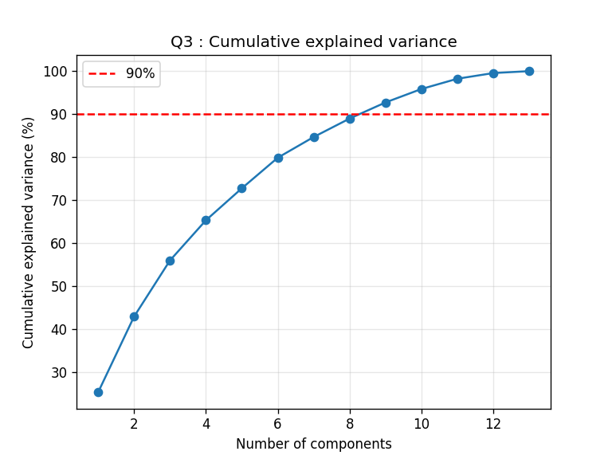
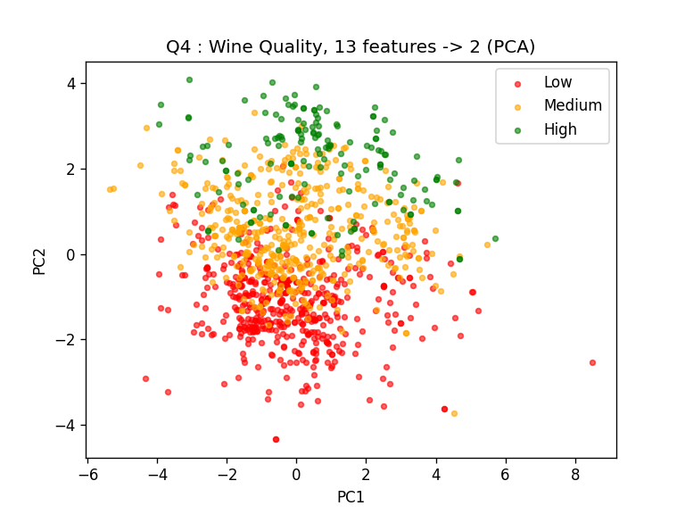

# Lab 10 : PCA on Wine Quality Dataset

Reducing the 13 features of the [Wine Quality dataset](https://www.kaggle.com/datasets/yasserh/wine-quality-dataset) (`WineQT.csv`, 1143 rows) to 2 features using Principal Component Analysis.

## What is PCA?

PCA (Principal Component Analysis) is an unsupervised dimensionality reduction technique. It finds new axes, called principal components, along which the data varies the most, and projects the data onto the top few of them.

- Each principal component is a weighted mix of all the original features, so it is a **new** feature. That is why PCA is called feature extraction, not feature selection.
- PC1 captures the most variance, PC2 the next most, and so on. The components are perpendicular to each other.
- It does not use labels at all, only the features.

## Steps to calculate PCA

1. **Standardize the data** : z = (x − μ) / σ, so every feature has mean 0 and std 1.
2. **Covariance matrix** : C = (Zᵀ Z) / (n − 1). For 13 features this is 13 × 13.
3. **Eigenvalues and eigenvectors** : solve C v = λ v, i.e. det(C − λI) = 0. Each eigenvector is a direction, and its eigenvalue is the variance along it.
4. **Rank the components** : sort by eigenvalue, largest first. Explained variance of PCi = λi / Σλ.
5. **Select top k** : take the first k eigenvectors as W (13 × k). Here k = 2.
6. **Transform** : Y = Z W, which gives n × 2.

The notebook also does these steps by hand on 3 sample rows.

## Results

- PC1 = 25.19 %, PC2 = 17.63 %, so **42.82 %** of the variance is kept with 2 components
- 9 components are needed to keep at least 90 % of the variance
- Without standardization, PC1 alone explains 99.46 %, because `Id` and the sulfur dioxide columns have huge variances
- The sklearn result and the from-scratch NumPy result are the same

## Files

| File | What it is |
|---|---|
| `Lab10_PCA_WineQuality.ipynb` | Main notebook : sklearn PCA, PCA from scratch, hand calculation, answers to the 5 questions |
| `pca_wine_quality.py` | Same thing as one Python script, prints answers to all 5 questions |
| `PCA_Questions.pdf` | Lab questions |
| `WineQT.csv` | Dataset |
| `q3_cumulative_variance.png`, `q4_pca_scatter.png` | Plots |

To run : keep `WineQT.csv` in the same folder and run `python3 pca_wine_quality.py`, or open the notebook in Colab.
